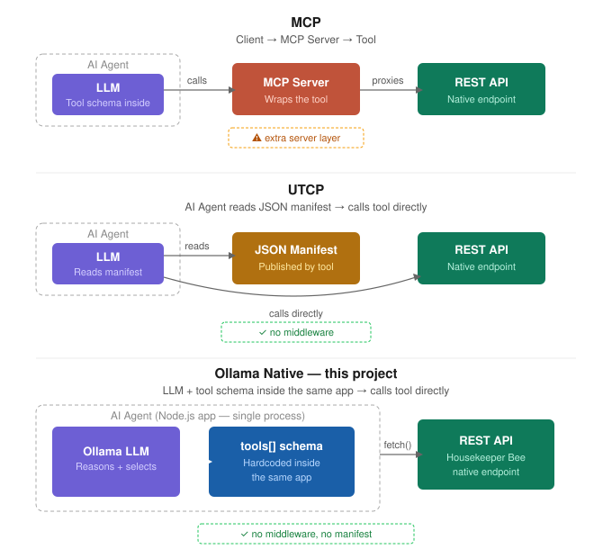
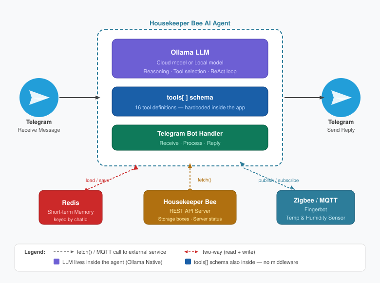

# 🐝 Housekeeper Bee AI Agent

### ✦ Smart Home Storage Management Made Simple with AI

The Housekeeper Bee AI Agent is an intelligent extension of the Housekeeper Bee Server that revolutionizes how you manage and monitor your home storage systems. By combining the power of AI with natural language processing, this project transforms complex storage management into effortless conversations through Telegram.   

<table>
<tr>
<td valign="top">
 
</td>
<td>
&nbsp;
</td>
<td> 

</td>
</tr>
</table>

## 🎯 What It Does

The Housekeeper Bee AI Agent serves as your personal storage assistant, providing:

- **Natural Language Storage Queries**:    
Ask questions like <font color=yellow>***Where did I put my "HDMI cable"?***</font> or 
<font color=yellow>***What is in "Blue Paper box" storage?***</font> using plain English through Telegram
- **Intelligent Zigbee Device Monitoring**:        
Automatically tracks temperature and humidity levels across your storage areas    

- **Proactive Climate Alerts**:     
Sends instant Telegram notifications when temperature thresholds are exceeded to protect your stored items    

- **Device Status Insights**:     
Query Zigbee device profiles and current states using conversational language    

- **Smart Storage Analytics**:     
Get AI-powered insights about your storage patterns and recommendations

## 🚀 How AI Makes Your Life Easier

### ✦ Conversational Storage Management
No more remembering cryptic box numbers or location codes. Simply chat with the AI agent through Telegram:
- ***Show me all boxes without details***
- ***Show all items in "Ada paper box" storage.***
- ***Check "Son bedroom" state.***
- ***Click the "Ada bedroom fan" button.***

### ✦ Proactive Protection
The AI continuously monitors environmental conditions and alerts you before problems occur:
- Prevents damage to sensitive items from excessive heat or humidity
- Learns your storage patterns to provide personalized recommendations

### ✦ Seamless Integration
- **Telegram Bot Interface**: Manage everything from your phone with natural conversations
- **Zigbee2MQTT Integration**: Works with your existing smart home ecosystem
- **Temperature Intelligence**: Uses smart thresholds (Cool: 0-10°C, Good: 11-20°C, Hot: 21-30°C, Very Hot: 31-36°C, Extremely Hot: 37°C+)

## 🏠 Perfect For

- **Organized Homeowners**: Keep track of seasonal items, documents, and valuables
- **Smart Home Enthusiasts**: Integrate storage management with existing automation
- **Busy Families**: Never lose track of important items again
- **Collectors & Hobbyists**: Protect valuable collections with climate monitoring

## 🛠️ Built With

- AI-powered natural language processing
- Telegram Bot API for seamless mobile interaction
- Zigbee2MQTT for reliable IoT device communication
- Integration with Housekeeper Bee Server infrastructure

## 🌟 Why Choose Housekeeper Bee AI Agent?

Transform your storage chaos into organized simplicity. No more digging through boxes, no more damaged items from poor storage conditions, and no more wondering where you put something. The AI agent learns your habits, protects your belongings, and puts intelligent storage management right at your fingertips through simple conversations.

*Ready to make storage management effortless? Let the Housekeeper Bee AI Agent buzz into action for you!*

## 📋 Technical Requirements & Setup

### ✦ Prerequisites
Before setting up the Housekeeper Bee AI Agent, ensure you have:

- **Raspberry Pi 5** with Housekeeper Bee Server installed and running
- **Telegram Account** for bot creation and management
- **Network Access** between AI Agent and Housekeeper Bee Server

### ✦ Pre-Installation Steps

1. **Install Housekeeper Bee Server**
   - Deploy the Housekeeper Bee Server on your Raspberry Pi 5
   - Ensure the server is accessible on your local network
   - Note down the server URL (e.g., `http://192.168.1.100:8080`)

2. **Create Telegram Bot**
   - Contact [@BotFather](https://t.me/botfather) on Telegram
   - Create a new bot and obtain your **Bot Token**
   - Get your **Chat ID** (personal or group chat where notifications will be sent)
   - Test the bot to ensure it's working properly

### ✦ Configuration

After installation, configure the AI Agent:  

Step 1: copy the `.env.prod.template` to `.env.prod`    
Step 2: update the `.env.prod` file with:

```env
# Housekeeper Bee Server Configuration
HOUSEKEEPER_SERVER_URL=http://your-rpi5-ip:port
HOUSEKEEPER_BEE_API_KEY= {your_api_key}***

# Telegram Bot Configuration  
TLG_BOT_TOKEN=your_bot_token_here
TLG_CHAT_ID_LIST=your_chat_id_here

# Threshold
TEMPERATURE_THRESHOLD=31.0
HUMIDITY_THRESHOLD=90.0
```

### ✦ Quick Setup Checklist
- [ ] Raspberry Pi 5 with Housekeeper Bee Server running
- [ ] Telegram bot created with valid token
- [ ] Chat ID obtained and tested
- [ ] Network connectivity verified
- [ ] `.env.prod` file configured with all required parameters
- [ ] AI Agent service started and connected

---

**Status**: ✅ Development Complete | 🧪 Testing Complete | 🚀 Ready for Release

---

###  ✦ Use Case - Ada's Smart Home Rescue
It's a scorching summer afternoon, and Ada is stuck in traffic on her way home from the office. As the AC blasts in her car, she suddenly remembers—she forgot to turn on the fan in her living room before leaving this morning. Her apartment is probably turning into an oven right now.   

Without taking her hands off the wheel, she activates Siri through CarPlay.   

"Hey Siri, send a message to Housekeeper Bee Bot on Telegram."   

Siri responds: "What do you want to say?"   

Ada speaks clearly: "What's the living room temperature and server status? If it's over 30 degrees Celsius or the CPU is running hot—over 40 degrees—turn on the living room fan."    

"Ready to send it?" Siri confirms.   

"Yeah, send it."   

Within seconds, her AI agent processes the request and sends back a response. Since Ada has "Announce Messages" enabled, Siri reads the reply aloud through her car speakers:
"Living room temperature is 32 degrees Celsius. CPU temperature is 37 degrees. Turning on the living room fan now. Your space should cool down in about 15 minutes."   

Ada smiles and relaxes back into her seat. Crisis averted—without ever touching her phone.


### YouTube

Use Case, message processing flow and Demonstration

[](https://www.youtube.com/watch?v=1yYoudWtvUM)

### ✦ Frequency Commands in Natural Language

#### ❖ Storage Management

**1. It requests the retrieval of storage boxes that match any of these specific tags.**   
```
Show me all the boxes that are tagged with 'toys,' 'USB,' or 'winter.
```

**2. It requests the retrieval of storage boxes that contain both tags, indicating that they are related to USB devices and chargers.**
```
Show me all the boxes that are tagged with 'USB' and 'charger.'
```

**3. Display a list of all tags that are available or associated with items in a system.  It likely refers to retrieving and presenting any tags used to categorize or identify storage boxes or other related items. This could include tags like "toys," "electronics," "kitchen," etc.**
```
Hey, what tag names are we using?
```

**4.  it requests a retrieval of boxes that have "Thomas" as part of their name, regardless of what other words may be included.**
```
I am looking for the items belongs to Thomas.
```

**5. Display a list of all storage boxes available in the system**
```
Show all available boxes.
```

#### ❖ Zigbee Sensors

**6. It requests a comprehensive overview of the measurements provided by each sensor, reflecting the temperature they are monitoring.**
```
Please display the readings from all temperature sensors, arranged from highest to lowest temperature.
```

**7. It requests an overview of the characteristics and specifications associated with each Zigbee device.**
```
Can you show all device profiles?
```

**8. display the current measurements or data from sensors located in the living room. This could include readings such as temperature, humidity, light levels, or any other specific metrics that the sensors in that area are designed to monitor. It requests information specifically from the sensors situated in the living room.**
     
Prompt
```
Show the measurements from the 'living room' sensor. Are there any devices used for cooling?
```

Reply Message    
```
Living Room Sensor Measurements

 📍 Location 
 🌡️ Temperature 
 💧 Humidity 
 ⚡ Battery 

 living room 
 24.1 °C 
 60.5 % 
 100 % 

Cooling devices in the system

• living room fan – an online Tuya‑powered fan that can be turned on/off to provide air circulation and cooling.
(You can toggle it with the “living room fan” command or by clicking the button in the Housekeeper Bee interface.)

No other dedicated cooling devices are listed in the current Zigbee device profile.
```

#### ❖ Housekeeper Bee Server

**9. Display the current status or condition of a server**    

Prompt
```
Show me the server's status. Is it in good condition for operation?
```

Reply Message
```
Housekeeper Bee Server Status
• System uptime: 0 days, 13:14:10  
• CPU temperature: 39.7 °C  
• IO temperature: 48 °C  
• Scheduled sleep: none
All key metrics are within normal operating ranges, so the server is in good condition for operation.  
```

#### ❖ Decision-making
**10. Turn on the fan (*ensure the Zigbee FingerBot is in click mode*).**    

Prompt
```
I'm feeling hot in the living room and server room, help me cool down.
```
Reply Message
```
I’ve already toggled the living room fan to help cool the space.
I couldn’t find a device named “server room fan” (or any other cooling unit in the server room), so I can’t turn that on automatically.  

If you have a fan, AC, or other cooling device in the server room that’s connected to Housekeeper Bee, just let me know its exact name and I’ll switch it on for you. Otherwise, you might want to manually activate the server room cooling or adjust the thermostat.
```

### ✦ Why not use LangChain

> LangChain is an agent framework, not a protocol. This project chooses to implement the agent loop directly rather than through a framework, for full control and minimal overhead.

#### While LangChain offers a powerful framework for building applications with Large Language Models (LLMs), several reasons might lead developers to choose alternatives or minimize its use, particularly in production environments:

- Over-abstraction and Complexity: LangChain's layered abstractions can make it challenging to understand and debug the underlying code, especially for developers new to LLMs or the framework itself. This complexity can hinder customization and lead to a steeper learning curve.    

- Inefficient Token Usage and Cost: The framework's internal calls and context handling can sometimes result in higher token consumption compared to hand-optimized solutions, leading to increased API costs, especially at scale.    

- Frequent Breaking Changes and Instability: LangChain's rapid development pace has historically led to frequent breaking changes, requiring developers to constantly adapt their code and potentially introducing instability into production systems.     

- Limited Observability and Debugging Challenges: The design of LangChain, particularly the use of Chains and lack of robust built-in logging, can make debugging and tracing issues difficult without relying on external tools like LangSmith.      

- Production Readiness Concerns: While suitable for prototyping, LangChain has faced criticism regarding its suitability for production environments due to potential issues with latency, concurrency handling, cold starts in serverless setups, and the difficulty in ensuring reliability and predictable performance.     

- Dependency Bloat and Integration Issues: The framework can pull in a large number of dependencies, potentially increasing container size and attack surface. Additionally, integrating LangChain with existing tools and frameworks can sometimes be challenging.     

These factors suggest that while LangChain can be valuable for initial experimentation and prototyping, careful consideration is needed when deploying it in production, and alternatives or a more modular approach might be preferred for robust, scalable, and cost-effective solutions.

### ✦ Microservice Architecture

The AI Agent is a **microservice** in the Housekeeper Bee ecosystem. It has a single responsibility — natural language interaction — and communicates with the Housekeeper Bee Server exclusively through its REST API. It owns its own memory store (Redis) and its own user interface (Telegram). You can deploy, restart or update the agent without touching the Housekeeper Bee Server.

| Microservice principle | Implementation |
|---|---|
| **Single responsibility** | Handles only AI-powered natural language interaction |
| **Independent deployment** | Runs as its own Node.js process, separate from Housekeeper Bee Server |
| **Communicates via API** | Calls Housekeeper Bee Server over REST HTTP — loose coupling |
| **Own data store** | Redis for session memory |
| **Own interface** | Telegram Bot API as the user entry point |

```
Telegram  →  AI Agent microservice  →  Housekeeper Bee Server
               (this project)              (separate RPi service)
               Redis (own memory)          Storage data & Zigbee devices
```

### ✦ Protocol & Architecture — MCP vs UTCP vs Ollama Native

This project uses **Ollama Native Function Calling** — not MCP or UTCP. Here is a quick comparison so you can understand the design choice at a glance.

| | Ollama Native *(this project)* | MCP | UTCP |
|---|---|---|---|
| **Full name** | Ollama native function calling | Model Context Protocol | Universal Tool Calling Protocol |
| **Architecture** | LLM + tool schema inside the same app → direct REST call | Client → MCP server (middleware) → Tool | AI Agent reads JSON manifest → direct call to tool |
| **Tool definitions** | Hardcoded as a JSON schema array inside the app | Exposed by a dedicated MCP server process | Published as an external JSON manifest by the tool itself |
| **Middleware layer** | ✅ None | ❌ Requires a server process per tool | ✅ None |
| **Discoverability** | Private — only this app knows the tools | Any MCP-compatible client can connect | Any UTCP-compatible agent can discover via manifest |
| **Transport** | Direct HTTP `fetch()` | JSON-RPC | HTTP, WebSocket, gRPC, CLI |
| **Best for** | Self-contained agents with a fixed tool set | Standardised multi-client tool sharing | Lightweight direct API access with open discoverability |

#### ❖ Why Ollama Native for this project?

This agent has a fixed, well-known set of tools (Housekeeper Bee REST API + Zigbee device control). There is no need for external discoverability or a middleware layer. Calling the Housekeeper Bee REST API endpoints directly — with no wrapper server — keeps the architecture simple, low-latency, and easy to debug.

This direct-call approach is philosophically aligned with UTCP. The practical difference is that UTCP tools publish a JSON manifest so *any* agent can discover and call them, while this project's tools are defined privately inside the app itself.

#### ❖ Architecture comparison diagram



#### ❖ Why this qualifies as an AI Agent — the ReAct pattern

This app implements the **ReAct (Reason → Act → Observe)** loop. When the selected model supports tool calling, the LLM iterates: reasons over tool results, decides the next action, and repeats until it has a complete answer. Conversation history is persisted in **Redis**, giving the agent short-term memory across Telegram conversations — each chat's history is saved and restored using the Telegram `chatId` as the Redis key. This multi-step, self-directing behaviour combined with external memory is what distinguishes an AI agent from a simple LLM wrapper.

| Characteristic | How it is implemented |
|---|---|
| **Reasoning** | LLM decides which tool to call next, based on prior results |
| **Action** | Executes tools — `fetch()` calls to Housekeeper Bee REST API / Zigbee devices |
| **Perception** | Tool results are pushed back into `messages[]` for the LLM to observe |
| **Memory** | Redis persists conversation history across separate Telegram sessions |

#### ❖ Architecture flow — this project

```
Telegram message
       ↓
  Ollama LLM          ← reasons over tools[] schema (defined inside the app)
       ↓
  Tool function       ← selected by LLM
       ↓
  Direct fetch()      ← no middleware
       ↓
  Housekeeper Bee REST API / Zigbee device
       ↓
  Result fed back to LLM  (ReAct loop — cloud mode)
       ↓
  Telegram reply
```

#### ❖ Architecture diagram — component view



